

  <a href="https://ahmedhussain.tech"></a>

  

  
  
  
  

 

I'm an **AI Engineer** who ships **production LLM systems** end to end — the agent loop, the retrieval pipeline, the API, the app, the server it runs on, and the **evals that prove it works**. My systems are live on my own infrastructure behind TLS, with auth, failover, tracing and test suites. My final-year project is a live talking avatar of myself that holds real conversations on my behalf, and I build agents that sell, research and run outreach for real businesses.

> **How I work:** build it, measure it, fix what the numbers say. Every result on this page comes from a real eval or real usage.

 

  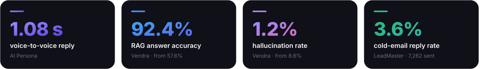

 

  <a href="https://github.com/ahmed-hussain-ai/aipersona"></a>
  <a href="https://ahmedhussain.tech"></a>

  <a href="https://ahmedhussain.tech"></a>
  <a href="https://ahmedhussain.tech"></a>

 

  
  
  
  

Status is checked live each time this page loads.

 

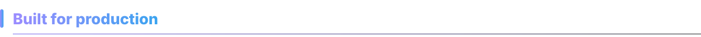

  

 

  

 

  

  
  
  
  
  
  
  
  
  

 

  
  
  

 

  

  

 

  Hiring for <b>AI Engineer</b>, <b>Agentic AI</b> or <b>AI Product</b> roles? I'd love to hear about it.  
  
  

  

